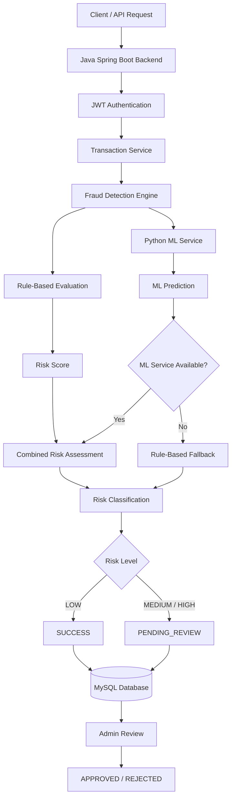
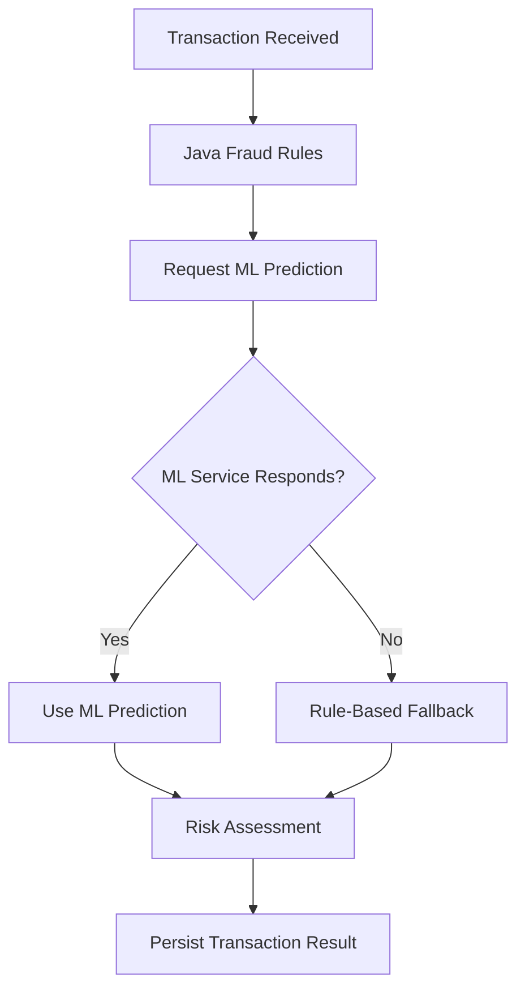
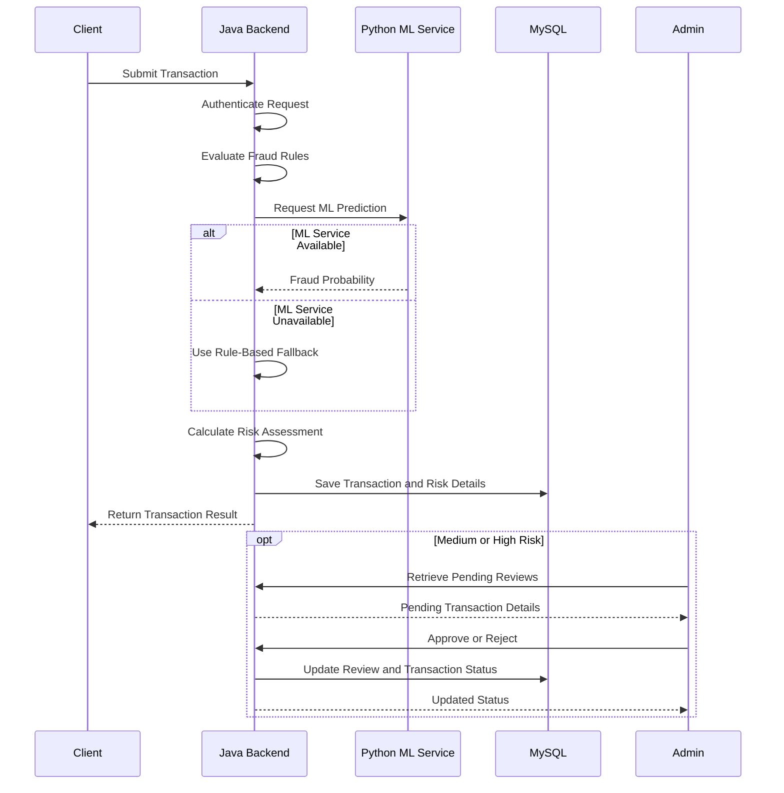

# 🛡️ AI Payment Fraud Detection System

<p align="center">
  <strong>An intelligent payment transaction monitoring system combining Java-based fraud detection rules with Machine Learning predictions.</strong>
</p>

<p align="center">
  <a href="https://github.com/sujithakrishna/ai-payment-fraud-detection-system">
    
  </a>
  
  
  
  
</p>

<p align="center">
  <a href="#-overview">Overview</a> •
  <a href="#-architecture">Architecture</a> •
  <a href="#-fraud-detection-engine">Fraud Detection</a> •
  <a href="#-machine-learning-model">Machine Learning</a> •
  <a href="#-api-documentation">API</a> •
  <a href="#-installation--setup">Installation</a>
</p>

---

## 📌 Overview

The **AI Payment Fraud Detection System** is a transaction monitoring platform designed to identify potentially fraudulent payment activities using a hybrid detection approach.

It combines:

- **Rule-Based Fraud Detection:** Java evaluates transaction behaviour against predefined fraud indicators.
- **Machine Learning Predictions:** A Python-based Random Forest model provides supplementary fraud probability predictions.
- **Risk Scoring:** Transactions receive a numerical risk score and LOW, MEDIUM, or HIGH classification.
- **Transaction Monitoring:** Potentially suspicious transactions are placed under review.
- **Admin Review Workflow:** Administrators can approve or reject transactions after reviewing them.

The system is designed with a key principle: **Java-based fraud rules remain authoritative, while Machine Learning acts as an additional risk assessment layer.**

## ✨ Key Features

| Feature | Description |
|---|---|
| 🔍 Transaction Monitoring | Evaluates incoming payment transactions |
| ⚙️ Rule-Based Detection | Identifies suspicious transaction patterns |
| 🤖 ML-Based Prediction | Uses a trained Random Forest model |
| 📊 Risk Scoring | Calculates transaction risk scores |
| 🚦 Risk Classification | Categorizes transactions into LOW, MEDIUM, and HIGH |
| 🔐 JWT Authentication | Secures protected API operations |
| 🧑‍💼 Admin Review | Supports manual approval and rejection |
| 🛟 ML Fallback | Allows rule-based detection when the ML service is unavailable |
| 🗄️ MySQL Persistence | Stores transaction and review information |

## 🏗️ Architecture

The application uses a two-service architecture.



### Technology Architecture

| Component | Technology | Responsibility |
|---|---|---|
| Backend | Java 21, Spring Boot | Business logic and transaction processing |
| Security | Spring Security, JWT | Authentication and authorization |
| Database | MySQL | Transaction and review persistence |
| ORM | Spring Data JPA | Database operations |
| ML Service | Python, FastAPI | Fraud probability predictions |
| ML Algorithm | Random Forest | Transaction classification |
| Model Persistence | Joblib | Saving and loading the trained model |
| API Testing | Postman | Endpoint validation |

## 🚨 Fraud Detection Engine

The Java fraud detection engine evaluates transactions using predefined rules.

### Detection Rules

| Rule | Condition | Risk Score |
|---|---|---:|
| High Transaction Amount | Amount greater than ₹10,000 | +40 |
| Transaction Frequency | More than 3 previous sender transactions within 10 minutes | +30 |
| Duplicate Transaction | Same sender, receiver, amount, and transaction type within 5 minutes | +20 |
| Location Change | Different transaction location within 10 minutes | +30 |

### Risk Classification

| Risk Score | Risk Level | Transaction Status |
|---:|---|---|
| Below 30 | 🟢 LOW | SUCCESS |
| 30–69 | 🟡 MEDIUM | PENDING_REVIEW |
| 70 and above | 🔴 HIGH | PENDING_REVIEW |

**Example:**

A transaction involving a high amount and a different location can trigger multiple fraud rules.

```text
High Transaction Amount       +40
Different Transaction Location +30
-----------------------------------
Total Risk Score                70

Risk Level: HIGH
Transaction Status: PENDING_REVIEW
```

The risk score is based on the implemented detection rules and is not a direct probability of fraud.

## 🤖 Machine Learning Model

The ML component uses a **Random Forest Classifier** trained on a synthetic transaction dataset.

### Model Information

| Parameter | Value |
|---|---|
| Algorithm | Random Forest Classifier |
| Training Dataset | 20,000 synthetic transactions |
| Legitimate Transactions | 19,492 |
| Fraudulent Transactions | 508 |
| Test Dataset | 4,000 transactions |
| ML Decision Threshold | 0.60 |
| Model File | `transaction_fraud_model.pkl` |

### Model Features

The model uses the following transaction attributes:

1. Transaction amount
2. Transaction type
3. Payment method
4. Sender transaction count within 10 minutes
5. Receiver transaction count within 10 minutes
6. Minutes since the previous transaction
7. Location change indicator
8. Transaction hour

### Model Evaluation

The following results were obtained from the held-out synthetic dataset at different probability thresholds.

| Threshold | Precision | Recall | F1 Score | False Positive Rate |
|---:|---:|---:|---:|---:|
| 0.30 | 0.4190 | 0.8627 | 0.5641 | 0.0313 |
| 0.40 | 0.5122 | 0.8235 | 0.6316 | 0.0205 |
| 0.50 | 0.5755 | 0.7843 | 0.6639 | 0.0151 |
| **0.60** | **0.6937** | **0.7549** | **0.7230** | **0.0087** |
| 0.70 | 0.7634 | 0.6961 | 0.7282 | 0.0056 |

**Why was 0.60 selected?**

The 0.60 threshold provides a balance between fraud detection recall and false-positive reduction. Compared with 0.70, it detects more fraudulent samples while maintaining a relatively low false-positive rate.

> [!IMPORTANT]
> These metrics are based on synthetic data and controlled evaluation. They do not represent verified real-world fraud detection accuracy or production performance.

### ML Fallback Mechanism

The Java backend is designed to continue fraud detection even if the Python ML service becomes unavailable.



This prevents ML service availability from becoming a single point of failure for transaction processing.

## 🔄 Transaction Processing Workflow



## 📡 API Documentation

Base URL:

```text
http://localhost:8080
```

### Transaction APIs

| Method | Endpoint | Description |
|---|---|---|
| POST | `/api/transactions` | Submit a new transaction |
| GET | `/api/fraud-risk` | Retrieve fraud risk information |
| GET | `/api/fraud-risk/analyze/{id}` | Analyze a transaction |
| GET | `/api/fraud-risk/transaction/{id}` | Retrieve risk information for a transaction |

### Admin Review APIs

| Method | Endpoint | Description |
|---|---|---|
| GET | `/api/reviews/pending` | Retrieve pending reviews |
| POST | `/api/reviews/{id}/approve` | Approve a transaction review |
| POST | `/api/reviews/{id}/reject` | Reject a transaction review |

> **Note:** Protected endpoints require valid JWT authentication. The review ID in review endpoints refers to the review record, not the transaction ID.

### Example Transaction Request

```json
{
  "senderId": 1,
  "receiverId": 2,
  "amount": 18000,
  "transactionType": "TRANSFER",
  "paymentMethod": "UPI",
  "location": "Bangalore"
}
```

*Adjust request field names and values according to the DTO validation rules in the current implementation.*

### Example Response

```json
{
  "transactionId": 73,
  "amount": 18000,
  "riskLevel": "HIGH",
  "riskScore": 70,
  "riskReason": "High transaction amount; Transaction from different location",
  "transactionStatus": "PENDING_REVIEW"
}
```

*Illustrative response based on a previously tested transaction. Exact response fields depend on the current API implementation.*

## 🗄️ Database

The application uses MySQL for persistent storage.

Database name:

```sql
payment_fraud_detection
```

The database layer is responsible for persisting:

- User information
- Payment transactions
- Fraud risk assessment details
- Transaction review records

The project uses Spring Data JPA for database access.

## 🛠️ Installation & Setup

### Prerequisites

Install the following:

- Java Development Kit 21
- MySQL Server
- Python compatible with the installed ML dependencies
- Git
- Postman (optional, for API testing)

### 1. Clone the Repository

```bash
git clone https://github.com/sujithakrishna/ai-payment-fraud-detection-system.git
cd ai-payment-fraud-detection-system
```

### 2. Configure MySQL

Create the database:

```sql
CREATE DATABASE payment_fraud_detection;
```

Configure the required database tables using the project's database schema.

### 3. Configure Spring Boot

Copy the example configuration:

**Windows PowerShell:**

```powershell
Copy-Item src/main/resources/application-example.properties src/main/resources/application.properties
```

Set the required environment variables:

```powershell
$env:DB_USERNAME="root"
$env:DB_PASSWORD="your_mysql_password"
$env:JWT_SECRET="your_secure_jwt_secret"
```

Use a securely generated JWT secret of sufficient length for the configured HMAC signing algorithm.

Do not commit `application.properties` or expose credentials in source control.

### 4. Start the Python ML Service

Open a terminal in the project root:

```powershell
cd ml-service
```

Create a virtual environment:

```powershell
python -m venv venv
```

Activate it:

```powershell
.\venv\Scripts\Activate.ps1
```

Install dependencies:

```powershell
pip install -r requirements.txt
```

Start the FastAPI service:

```powershell
uvicorn app:app --host 127.0.0.1 --port 8000 --reload
```

ML service:

```text
http://127.0.0.1:8000
```

### 5. Start the Java Backend

Open a second terminal in the project root:

```powershell
.\mvnw.cmd spring-boot:run
```

Backend service:

```text
http://localhost:8080
```

### 6. Test the APIs

Use Postman to:

1. Authenticate and obtain a JWT.
2. Submit payment transactions.
3. Inspect fraud risk scores.
4. Test different transaction patterns.
5. Retrieve pending reviews.
6. Approve or reject transactions.

## 📂 Project Structure

```text
ai-payment-fraud-detection-system/
│
├── ml-service/
│   ├── app.py
│   ├── evaluate_thresholds.py
│   ├── generate_synthetic_data.py
│   ├── requirements.txt
│   ├── synthetic_transactions.csv
│   ├── train_synthetic_model.py
│   └── transaction_fraud_model.pkl
│
├── src/
│   ├── main/
│   │   ├── java/com/sujitha/aipaymentfrauddetection/
│   │   │   ├── config/
│   │   │   ├── controller/
│   │   │   ├── dto/
│   │   │   ├── entity/
│   │   │   ├── repository/
│   │   │   ├── security/
│   │   │   └── service/
│   │   │
│   │   └── resources/
│   │       └── application-example.properties
│   │
│   └── test/
│
├── .gitignore
├── LICENSE
├── pom.xml
├── requests.http
└── README.md
```

## 🔒 Security Considerations

- JWT-based authentication is used to secure API operations.
- Database credentials and JWT secrets are supplied through environment variables.
- Local application configuration is excluded from Git.
- The ML service is configured to run on the local loopback interface by default.
- Transaction review operations are handled through protected backend endpoints.

**Production deployment should additionally include** HTTPS, secret management, role-based access verification, rate limiting, audit logging, monitoring, and security testing.

## ⚠️ Current Limitations

- The ML model is trained on synthetic transaction data.
- Model performance has not been validated against real-world payment fraud datasets.
- Fraud detection rules use predefined thresholds that may require tuning for different payment environments.
- Production deployment requires additional operational, security, and model-monitoring controls.

## 🚀 Future Enhancements

- Real-time transaction anomaly detection
- Advanced behavioural analysis
- Explainable AI-based fraud insights
- Model retraining and performance monitoring
- Transaction analytics dashboard
- Configurable fraud detection thresholds
- Enhanced audit trails and alert notifications
- Production-ready deployment and monitoring

## 🧪 Testing

The project has been validated with scenarios covering:

- High-value transactions
- Frequent transactions within a short time window
- Duplicate transactions
- Location changes
- Combined fraud indicators
- ML service unavailability and rule-based fallback
- Admin approval and rejection workflows

## 👨‍💻 Author

**Sujitha V K**

M.Tech – Artificial Intelligence & Data Science

[](https://github.com/sujithakrishna)

[](https://www.linkedin.com/in/sujitha-v-k-77a924258/)

---

<p align="center">
  <strong>Built to explore intelligent, reliable, and explainable payment fraud detection.</strong>
</p>

<p align="center">
  ⭐ If you find this project interesting, consider starring the repository!
</p>
